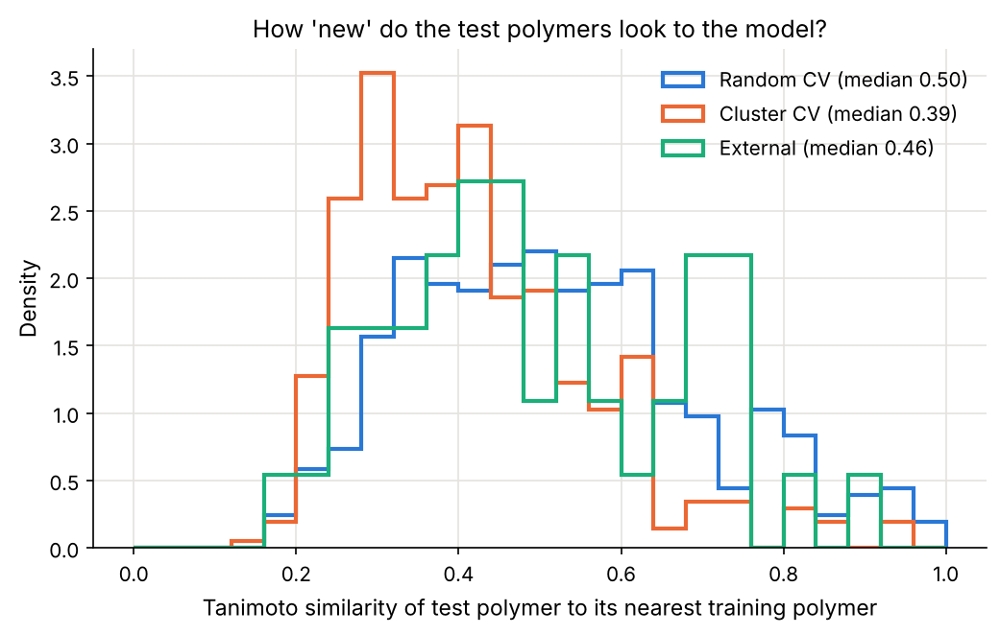
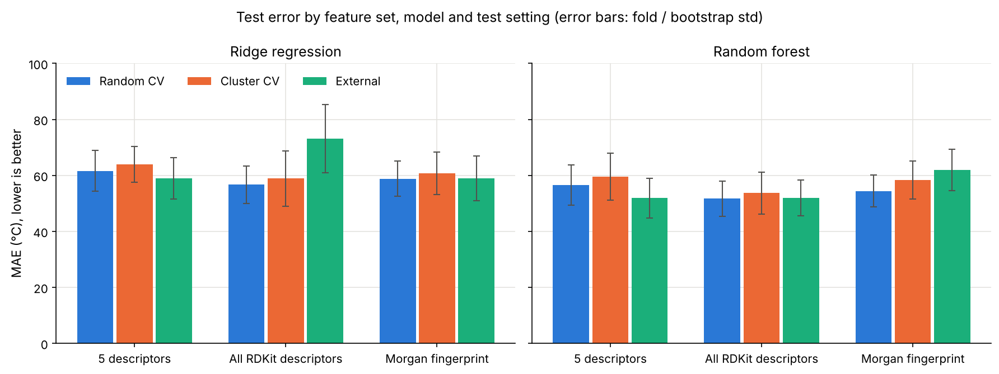
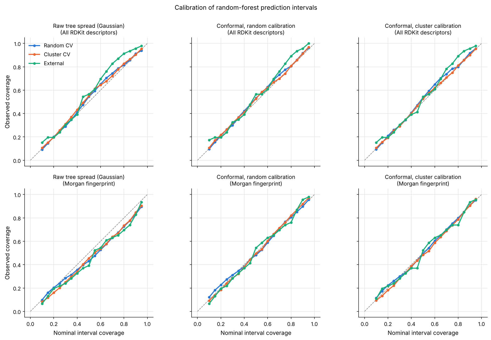
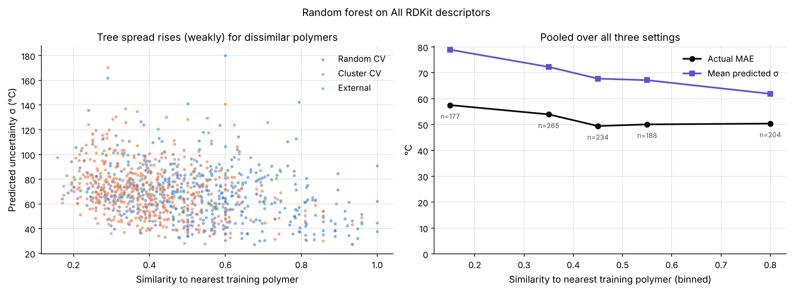

# Polymer-Tg-generalization

**How well do glass-transition-temperature (Tg) models generalize to chemically dissimilar
polymers, and do their uncertainty estimates stay calibrated when they don't?**

Machine-learning models for polymer Tg are usually scored on a random train/test split.
When such a model is used to screen *new* polymers, those polymers are often chemically
unlike anything in the training data. This project measures how much that matters on a
small public dataset (511 polymers) and whether random-forest uncertainty estimates can
warn us when a prediction is less trustworthy.

## Key results

| Random forest, all RDKit descriptors | Random CV | Cluster CV (dissimilar) | External set |
|---|---|---|---|
| MAE (°C) | 51.7 ± 6.3 | 53.7 ± 7.4 | 51.9 ± 6.4 |
| R² | 0.62 ± 0.08 | 0.56 ± 0.13 | 0.57 ± 0.13 |
| 90% interval coverage (conformal) | 0.92 | 0.91 | 0.96 |
| Mean 90% interval width (°C) | 228 | 238 | 247 |

*± = standard deviation over 5 folds (CV) or over 1000 bootstrap resamples (external set).
Predicting the training mean gives MAE ≈ 83-90 °C and a 90% interval ≈ 350 °C wide.*

1. **Generalization.** Holding out whole chemical clusters costs only ~2-4 °C MAE, less than
   the fold-to-fold spread. Random CV on 511 diverse polymers is already fairly
   out-of-distribution (median nearest-neighbour similarity 0.50 vs 0.39 for cluster CV).
2. **Feature sets.** All RDKit descriptors + random forest is best in every setting.
   Morgan fingerprints alone are not better than descriptors at this data size.
   High-dimensional linear models fail on the external set (R² < 0) because they extrapolate.
3. **Calibration.** Conformal-calibrated intervals stay close to their nominal coverage in all
   three settings. Raw tree spread was over-confident for the fingerprint forest
   (~83-85% coverage at nominal 90%), so a calibration step is needed.
4. **Uncertainty vs OOD.** Predicted uncertainty rises for polymers that are dissimilar to
   the training set (Spearman ρ ≈ -0.3 with similarity in CV), but it is only a weak
   predictor of the error of an individual polymer (ρ ≈ 0.3), and intervals are wide.
5. **Interpretability.** SHAP shows the model mostly learned "more sp3 carbon / more
   flexible chain → lower Tg", consistent with polymer physics.

<p align="center">
  
  
</p>
<p align="center">
  
  
</p>

## Approach

| Step | Method | Why |
|---|---|---|
| Cleaning | RDKit canonical SMILES, merge duplicates, remove train/external overlap | prevent leakage |
| Features | 5 hand-picked descriptors · ~180 RDKit descriptors · Morgan fingerprints (r=2, 2048 bits) | compare physical vs. structural representations |
| Models | Ridge regression, random forest (300 trees, no tuning) | robust on ~500 data points |
| Test settings | 5-fold random CV · 5-fold **cluster CV** (Butina clusters on Morgan fingerprints) · external `dataset3.csv` | no shift · chemical shift · mostly Tg-range shift |
| Uncertainty | random-forest tree spread σ, calibrated with normalized conformal prediction (inner 5-fold CV) | free with the best model; calibration without distribution assumptions |
| OOD measure | Tanimoto similarity to the nearest training polymer | standard applicability-domain measure |
| Interpretability | SHAP (TreeExplainer) | direction and size of each descriptor's effect |

Murcko scaffold splits were rejected because 22% of the repeat units have no ring at all
(one giant "empty scaffold" group).

## Repository layout

```
├── data/                         put the Kaggle data here (not included - see "Data source")
│   ├── train.csv
│   └── train_supplement/dataset3.csv   external test set
├── notebooks/
│   └── polymer-uncertainty-baseline.ipynb   the full analysis, run top to bottom
├── src/polymer_tg/               reusable code imported by the notebook
│   ├── data.py          loading, canonicalization, de-duplication
│   ├── features.py      descriptors and Morgan fingerprints
│   ├── splits.py        similarity, Butina clustering, CV splits
│   ├── evaluation.py    models, metrics, the three test settings
│   ├── uncertainty.py   tree spread, conformal calibration, coverage
│   └── plotting.py      shared colours and figure saving
├── figures/                      all figures, written by the notebook
└── requirements.txt
```

## How to run

```bash
python -m venv .venv
```

```bash
source .venv/bin/activate
```

```bash
pip install -r requirements.txt
```

```bash
cd notebooks
jupyter nbconvert --to notebook --execute --inplace polymer-uncertainty-baseline.ipynb
```

Or open the notebook in Jupyter and choose *Run All*. A full run takes about 7 minutes on a
4-core machine (most of it in the uncertainty section). All random seeds are fixed
(`SEED = 42`), so the numbers above reproduce exactly.

## Limitations and future work

- Small data: 511 training and 46 external polymers; error bars are wide and differences of
  a few °C between methods are not significant.
- One clustering cutoff (0.7). A sweep over cutoffs would show how error and calibration
  change as test polymers become progressively more dissimilar.
- Standard small-molecule featurization of a single repeat unit; polymer-aware
  representations (e.g. oligomers / periodic SMILES, backbone vs side-chain features)
  are likely to help.
- Random forests cannot predict outside the training Tg range, which limits accuracy for
  very high-Tg polymers.
- Alternatives worth trying for uncertainty: a Gaussian process with a Tanimoto kernel,
  or quantile regression forests.

## Data source

The data comes from the Kaggle competition
[**NeurIPS - Open Polymer Prediction 2025**](https://www.kaggle.com/competitions/neurips-open-polymer-prediction-2025)
(`train.csv` and the supplementary `dataset3.csv`). All credit for the data goes to the
competition organizers and the original data providers. The data is subject to the
competition's rules and is not redistributed here. To reproduce the analysis, download the
competition data from Kaggle and place `train.csv` in `data/` and `dataset3.csv` in
`data/train_supplement/`.

## Acknowledgements

This project was developed with the help of an AI coding assistant (Claude Code, by
Anthropic).
